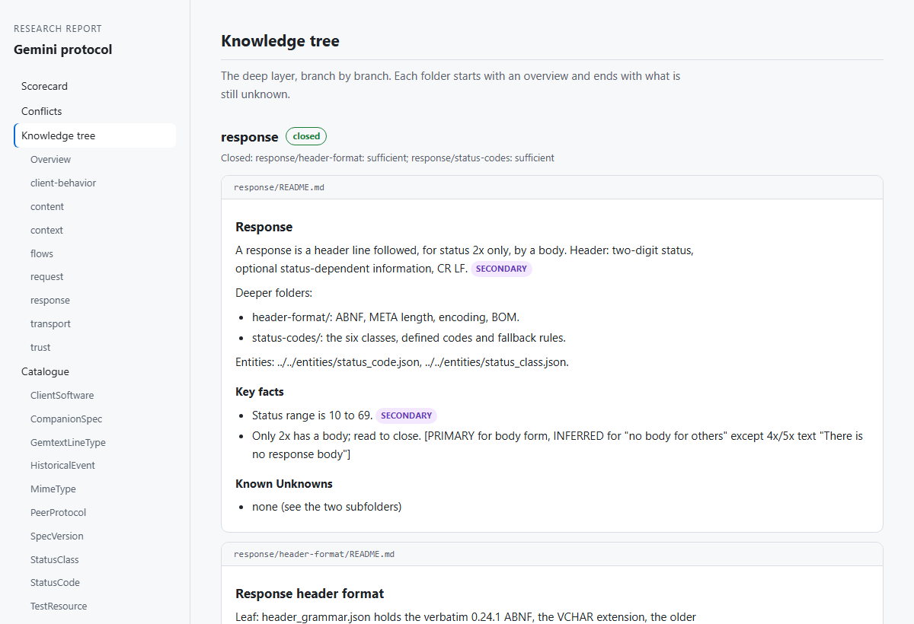

<h1 align="center">rankinbc / claude-plugins</h1>

<p align="center">
  <strong>Make Claude Code trustworthy where it usually isn't: research you can check,<br>
  secrets it never sees, new projects that start with a plan, and a code map that cites its evidence.</strong>
</p>

<p align="center">
  <a href="https://github.com/rankinbc/claude-plugins/actions/workflows/recursive-research.yml"></a>
  <a href="https://github.com/rankinbc/claude-plugins/actions/workflows/secret-courier.yml"></a>
  <a href="https://github.com/rankinbc/claude-plugins/actions/workflows/project-scaffolder.yml"></a>
  <a href="https://github.com/rankinbc/claude-plugins/actions/workflows/marketplace.yml"></a>
  <a href="LICENSE"></a>
  <a href="https://claude.com/claude-code"></a>
</p>

## Why use these

Claude Code is good at doing things. These plugins cover four places where
"it usually works" is not good enough, and each one backs its promise with
something you can verify rather than a prompt asking Claude to be careful.

| The problem | The plugin | What makes it hold |
|---|---|---|
| Research comes back fluent and confident, and you can't tell which claims are real | **recursive-research** | Every top-tier claim quotes its source, and a script opens the source and checks the words are there. Claims that fail are downgraded, with the reason. |
| To use an API key, Claude has to see it, and then it lives in the transcript, a file or a shell history | **secret-courier** | Claude only ever handles the key's *name*. Values are encrypted on your machine and delivered by scripts; hooks refuse any tool call that would expose one, and refuse everything if they cannot run. |
| A new project starts with Claude improvising the structure, and it drifts from session to session | **project-scaffolder** | A short interview, parallel research and a design you approve, then a scaffolded project with written conventions, tests that enforce them and a build plan Claude follows. |
| Asked "what calls this?", Claude greps, opens every look-alike and still misses the call that crosses a job queue into another service | **citegraph** | A local index of who calls whom, across Python and C# and across services. Every answer is a chain of `path:line` steps with the rule that linked them and a confidence, and on a labelled benchmark it finds callers more precisely than grep. |

All four are free and MIT licensed, run locally, and are tested on every change
(recursive-research and project-scaffolder on Windows, macOS and Linux).
recursive-research needs nothing beyond Python's standard library.

## Install

Inside [Claude Code](https://claude.com/claude-code), add the marketplace once:

    /plugin marketplace add rankinbc/claude-plugins

Then install whichever plugins you want, and start a new session (plugins load at startup):

    /plugin install recursive-research@rankinbc
    /plugin install secret-courier@rankinbc
    /plugin install project-scaffolder@rankinbc
    /plugin install citegraph@rankinbc

## The plugins

| Plugin | Use it when | Runs on |
|---|---|---|
| [**recursive-research**](plugins/recursive-research) | You need to really understand a subject (a protocol, a market, a codebase's ecosystem) and want a knowledge base you can trust and build on | Windows, macOS, Linux · Python 3.9+ |
| [**secret-courier**](plugins/secret-courier) | Claude needs to run, deploy or test something that takes a credential, and you don't want the credential in the conversation | **Windows only** · PowerShell 7, Python 3.11+ |
| [**project-scaffolder**](plugins/project-scaffolder) | You're starting something with more than one moving part and want Claude to build it to a plan instead of improvising | Windows, macOS, Linux |
| [**citegraph**](https://github.com/rankinbc/citegraph) | You work in a Python or C# codebase, especially several services, and want Claude to know what calls what without reading half the repo | Windows, macOS, Linux · [uv](https://docs.astral.sh/uv/) |

### recursive-research: research you can check

Name a subject and say what you need it for. Claude plans the research, sends out
teams of researcher agents in stages you approve, and leaves a knowledge base in
your project with a report you can open in a browser. Every claim carries a tier
saying how well it is supported, and every top-tier claim carries the exact words
it rests on and where they are. A script opens each source and checks the words
are really there; a claim that fails is downgraded, with the reason recorded.

<p align="center">
  <picture>
    <source media="(prefers-color-scheme: dark)" srcset="plugins/recursive-research/docs/images/report-dark.png">
    
  </picture>
</p>

Standard library only, no dependencies. [Read more](plugins/recursive-research#readme).

### secret-courier: Claude uses the name, never the value

You type a secret once at a masked prompt; it is encrypted on your machine. From
then on Claude works with a name (`github-pat`), and the plugin delivers the value
where the job needs it (a child process, a git-ignored config file, an HTTPS
check) and records every plaintext copy so it can be swept.

```
> /courier run --env GITHUB_TOKEN=dpapi:github-pat -- gh release create v1.2.0

Ran gh with GITHUB_TOKEN set in its environment only. The process has exited with code 0 and the
value is gone with it. Nothing was written to disk.
exit 0
```

Guard hooks check every shell command, file read, search and write before it runs,
and refuse anything that would expose a value. If the guard cannot run, the call
is refused. [SECURITY.md](plugins/secret-courier/SECURITY.md) states exactly what
it protects and what it cannot. [Read more](plugins/secret-courier#readme).

### project-scaffolder: start a project with a plan

Run `/project-scaffolder:new-project` in an empty folder and answer a few
questions. The plugin breaks your idea into components, researches each in
parallel, proposes a structure for you to approve, and scaffolds the project:
folder layout, conventions in `CLAUDE.md`, slash commands, a `.env` guard, and a
v1 build plan that `/execute-prp` follows. [Read more](plugins/project-scaffolder#readme).

### citegraph: a code map with evidence

Run `/citegraph:index` once in a project (and again after you pull; only changed
files are re-read). Claude can then ask who calls a function, what it calls, the
shortest path from an endpoint to the database, or where a config key is defined
and read. Answers come back as `path:line` steps, each with the rule that linked
them and a confidence, so Claude opens only the lines that matter. A C# API
enqueueing a job that a Python worker runs is one chain, not two dead ends:

```text
find_path("Site.Api.Endpoints.VersionEndpoints.ClassifyStems", "audio.stems.classify.classify_one")

step                                                  project               called at                         rule
Site.Api.Endpoints.VersionEndpoints.ClassifyStems     components/bff
→ app.tasks.classify_stems                            components/worker     src/Api/VersionEndpoints.cs:7     queue_match
→ audio.stems.classify.classify_stems                 components/analysis   app/tasks.py:8                    import_scope
→ audio.stems.classify.classify_one                   components/analysis   src/audio/stems/classify.py:6     same_file
```

It stores names and locations only, never source code or config values, redacts
anything secret-shaped, and the server is read-only. citegraph lives in
[its own repository](https://github.com/rankinbc/citegraph), which this marketplace
lists at a pinned release. [Read more](https://github.com/rankinbc/citegraph#readme).

## How this repository works

    .claude-plugin/marketplace.json   the marketplace ("rankinbc") listing every plugin
    plugins/<name>/                   one self-contained plugin per folder, with its own
                                      README, CHANGELOG, LICENSE and tests
                                      (citegraph is listed from its own repository, pinned to a tag)
    .github/workflows/<name>.yml      each plugin's CI, run only when that plugin changes
    scripts/check_marketplace.py      checks the marketplace and every manifest agree

- **Independent versions.** Each plugin is versioned on its own. A release is
  tagged `<plugin>--vX.Y.Z` (for example `recursive-research--v0.3.0`), and CI
  refuses a tag that does not match the version in that plugin's
  `.claude-plugin/plugin.json`.
- **Tested where it runs.** recursive-research and project-scaffolder are tested
  on Ubuntu, macOS and Windows; secret-courier on Windows, including its
  PowerShell operations under Pester.
- **No secrets in the tree.** secret-courier scans its own source for
  secret-shaped values in CI.

Working on a plugin? See [CONTRIBUTING.md](CONTRIBUTING.md). Found a security
problem? See [SECURITY.md](SECURITY.md).

## Moved from

These plugins used to live in their own repositories. Their full history was
imported here, and development continues here.

- [rankinbc/RecursiveResearch](https://github.com/rankinbc/RecursiveResearch) → [`plugins/recursive-research`](plugins/recursive-research)
- [rankinbc/Secret-Courier-Claude](https://github.com/rankinbc/Secret-Courier-Claude) → [`plugins/secret-courier`](plugins/secret-courier)
- [rankinbc/claude-project-scaffolder](https://github.com/rankinbc/claude-project-scaffolder) → [`plugins/project-scaffolder`](plugins/project-scaffolder)

If you installed from an old repository, switch over:

    /plugin marketplace remove recursive-research      # or: secret-courier
    /plugin marketplace add rankinbc/claude-plugins
    /plugin install <name>@rankinbc

## License

MIT. See [LICENSE](LICENSE); each plugin also carries its own copy.
