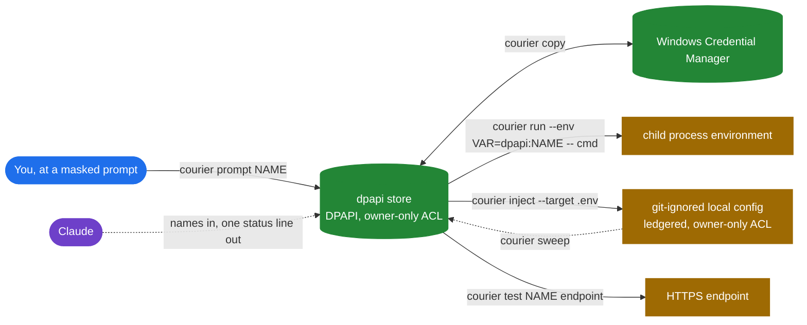
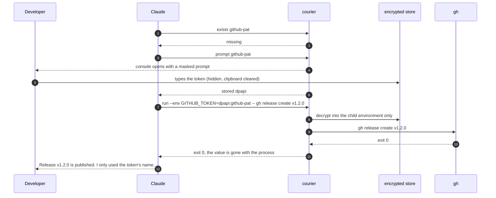
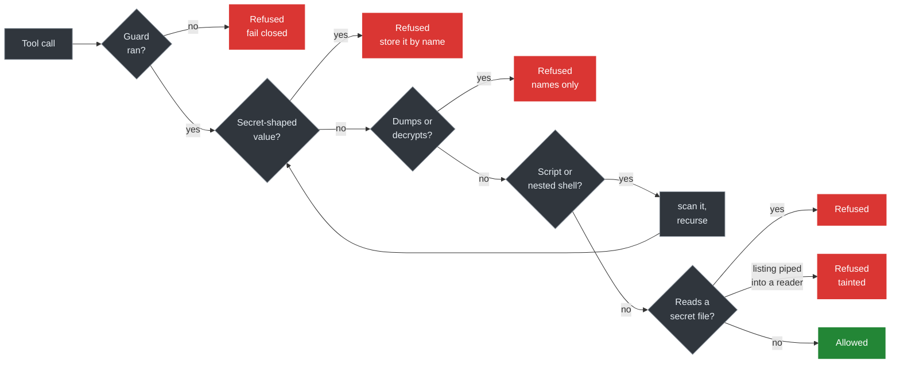

# secret-courier

[](https://github.com/rankinbc/claude-plugins/actions/workflows/secret-courier.yml)
[](https://github.com/rankinbc/claude-plugins/releases?q=secret-courier--v&expanded=true)
[](LICENSE)


**Let Claude Code use your API keys, tokens and passwords without ever seeing them.**

You type a value once at a masked prompt. It is encrypted on your machine. From then on Claude works with a
**name** (`github-pat`), and the plugin delivers the value where the job needs it: a child process, a
git-ignored config file, an HTTPS check. Every plaintext copy is on a ledger you can sweep. Guard hooks keep
Claude's own tools away from secret files and value-printing commands, and they fail closed.

```
> /courier run --env GITHUB_TOKEN=dpapi:github-pat -- gh release create v1.2.0

Ran gh with GITHUB_TOKEN set in its environment only. The process has exited with code 0 and the
value is gone with it. Nothing was written to disk.
exit 0
```

## Why

- Claude can publish a release, run a migration, wire an API client. Each needs a credential, and the easy
  paths (paste it, write it to a file, export it) leave the value where a model, a transcript or the next
  command can read it.
- A model needs the name, never the 40 characters behind it.
- Secrets leak through the copies nobody tracks. This plugin tracks them and removes them.

## How it keeps a secret safe

1. **Masked entry, encrypted at rest.** `courier prompt github-pat` opens a console on your machine. The
   value is read as a `SecureString` and DPAPI-encrypted for your Windows account (or stored in Credential
   Manager). The store has an owner-only ACL; the clipboard is cleared if it still holds the value.
2. **Only names cross to the model.** Every argument is validated as a name before a script runs. Each
   operation prints one `STATUS` line plus one sentence, never a value; output is redacted anyway, and a
   secret-shaped leak turns the result into an error.
3. **Delivery without exposure.** `run` puts the value in one child environment. `inject` writes only where
   git ignores the file, with an owner-only ACL, and records it. `test` sends one HTTPS request through
   `HttpClient`. No value ever passes to a PowerShell cmdlet as a parameter (host policy can log those).
4. **Guard hooks that fail closed.** Before every `Bash`, `PowerShell`, `Read`, `Grep`, `Glob`, `Write`, `Edit`
   and `NotebookEdit` call, a standard-library Python guard refuses secret-file reads, value dumps,
   secret-shaped values, and scripts or nested shells that would do any of those. If the guard cannot run,
   the call is refused.
5. **A ledger and a sweep.** `courier sinks` lists every plaintext copy the plugin wrote; `courier sweep`
   removes them. The encrypted stores are untouched.

## How it moves a secret



| Command | Does | Claude gets back |
|---|---|---|
| `courier prompt github-pat` | masked prompt, encrypted store | `stored dpapi` and where it lives |
| `courier exists github-pat` | which store holds the name | `found credman` and how it is protected |
| `courier run --env GITHUB_TOKEN=dpapi:github-pat -- gh release list` | value in one child environment | `exit 0`, "the value is gone with it" |
| `courier inject --target .env --format dotenv --map GITHUB_TOKEN=dpapi:github-pat` | git-ignored, ACL'd, ledgered file | the ledger id and the `sweep` command |
| `courier test github-pat github` | one HTTPS GET with the value in the header | `valid 200` or `invalid 401` |
| `courier copy dpapi:github-pat credman:github-pat` | move between stores, in memory | `stored credman` |
| `courier sinks`, `courier sweep` | list and remove plaintext copies | what was removed |
| `courier names`, `courier log`, `courier doctor` | inventory, audit trail, health | names and statuses only |

Stores: `dpapi` (encrypted file, default), `credman` (Windows Credential Manager). Read-only sources: `env`
and `keyvault:<vault>/<secret>` (your own `az login`, interactive). Sources are never destinations.

## A session

Claude is asked to publish a release and needs a GitHub token. No value appears anywhere in this exchange.



The console at step 4:

```
secret-courier: a value is needed for 'github-pat'
  Where it goes: the DPAPI file store, encrypted for the Windows account brian.
  What Claude sees: only the name 'github-pat' and the word 'stored'.
  Nothing leaves this machine. If you paste, the clipboard is cleared afterwards.
github-pat: ****************************************
Stored 'github-pat'. Nothing else was written.
```

## What the guard refuses



- **Values**: JWTs, access tokens, cloud keys, private key blocks, `Authorization` headers,
  `NAME_PASSWORD=...`, in a command, a prompt or a file being written.
- **Dumps**: `printenv`, `process.env`, `ConvertFrom-SecureString`, `keyring get`, `az keyvault secret show`,
  `aws secretsmanager get-secret-value`, `vault kv get`, `gh auth token`, credential-named variables, git
  config dumps, encoded PowerShell however nested.
- **Files**: `.env*`, `secrets.json`, `appsettings.local.json`, key and certificate files, `.netrc`,
  `~/.ssh`, `~/.aws`, `~/.azure`, `~/.kube`, including backups, short names, symlinks, globs (`cat .en?`)
  and listings fed into a reader (`cat $(ls .env)`).

Refusals say what to do instead: `courier exists <name>` to locate, `courier run` to deliver.

## Where a value can exist

| Kind | Protection | Find | Remove |
|---|---|---|---|
| `dpapi` store | DPAPI for your account, owner-only ACL | `courier names` | `courier remove dpapi:NAME` |
| `credman` store | the OS credential vault | `courier names` | `courier remove credman:NAME` |
| sink (plaintext file) | git-ignored, owner-only ACL, on the ledger | `courier sinks` | `courier sweep` |
| transit (child environment) | gone when the process exits | nothing to find | nothing to remove |

## Verified

- `courier doctor` runs a copy of the guard with an empty `PATH` and proves it refuses the call.
- The hook path is standard-library Python with no venv and no pip; a test diffs `sys.modules` to keep it so.
- CI runs `courier scan . --fail-on-findings` against the plugin folder itself; fixtures build secret-shaped
  strings at runtime.
- 156 pytest and 17 Pester cases on `windows-latest`, Python 3.11 and 3.13; no test touches the network.
- The policy overlay is add-only. `SECURITY.md` lists the limits: what a text-level guard cannot see, what a
  blocked prompt still leaves in the transcript, what DPAPI does not protect against.

## Install

Windows 10/11, PowerShell 7, Python 3.11+, Claude Code 2.1.295+. Windows only.

Inside Claude Code:

```
/plugin marketplace add rankinbc/claude-plugins
/plugin install secret-courier@rankinbc
```

Or from a terminal: `claude plugin marketplace add rankinbc/claude-plugins` then
`claude plugin install secret-courier@rankinbc`.

Restart Claude Code. Hooks, the `/courier` command and the `secret-courier` skill are registered; the first
line of the next session confirms it: `secret-courier 0.1.0: guard hooks active (Python 3.13, paste policy
advise).` Run `/courier doctor` to check every probe. Nothing is written to your machine until the first
`courier prompt`.

## Configure

`~/.secret-courier/guard-policy.json` adds deny-list entries and sets the paste policy:

```json
{ "denied_dirs": ["my-vault-dir"], "paste": "block" }
```

`~/.secret-courier/config.json` adds endpoints `courier test` may probe (ids reach the model, URLs do not):

```json
{ "endpoints": { "my-api": { "url": "https://api.example.com/me", "auth": "bearer", "expect": 200 } } }
```

`COURIER_HOME` moves the state directory. `COURIER_PYTHON` pins the interpreter.

## Inside

| Part | Role |
|---|---|
| `hooks/hooks.json`, `scripts/courier-guard.cmd` | hook wiring, fail-closed launcher |
| `src/courier/guard*.py`, `policy.py`, `patterns.py`, `scan.py` | the guard and the detector, stdlib only |
| `src/courier/bridge.py`, `cli.py`, `doctor.py` | validates names, runs ops, redacts |
| `powershell/Courier.psm1`, `CourierSinks.psm1`, `ops/*.ps1` | the only code that touches a value |
| `config/guard-policy.json`, `config/endpoints.json` | deny lists, endpoint catalogue |
| `skills/secret-courier/SKILL.md`, `commands/courier.md` | how Claude uses it |

From `plugins/secret-courier` in the [claude-plugins](https://github.com/rankinbc/claude-plugins) repository:

```
python -m pip install -e ".[dev]" && python -m pytest -q
pwsh -NoProfile -Command "Invoke-Pester -Path powershell/tests"
```

`CONTRIBUTING.md`, `SECURITY.md`, `CHANGELOG.md`. Roadmap: macOS and Linux backends, `courier rotate`. MIT.
